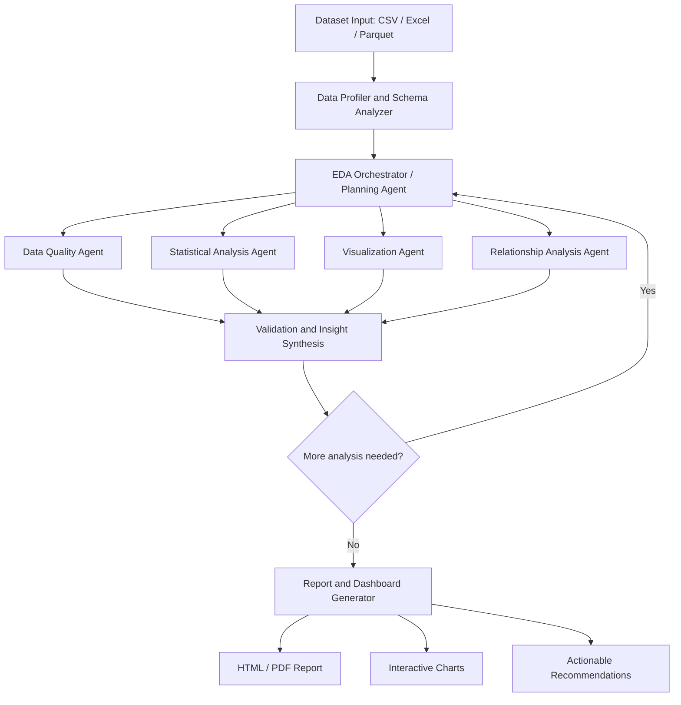

# Agentic Pipeline to Automate EDA

An AI-powered, agentic Exploratory Data Analysis (EDA) system that automatically profiles datasets, detects data-quality issues, selects relevant analyses, generates visualizations, validates findings, and produces a comprehensive report with actionable insights.

The goal is to combine **reliable Python-based analytics** with **LLM-powered planning and interpretation**. Python performs calculations; the LLM helps decide what to investigate and explains verified results.

---

## Table of Contents

- [1. Project Overview](#1-project-overview)
- [2. High-Level Architecture](#2-high-level-architecture)
- [3. Quick Start & Installation](#3-quick-start--installation)
- [4. Usage Guide](#4-usage-guide)
  - [4.1 Command Line Interface (CLI)](#41-command-line-interface-cli)
  - [4.2 Streamlit Interactive Web Studio](#42-streamlit-interactive-web-studio)
  - [4.3 FastAPI REST API](#43-fastapi-rest-api)
  - [4.4 Docker & Docker Compose](#44-docker--docker-compose)
- [5. Agent Responsibilities](#5-agent-responsibilities)
- [6. Agentic Workflow & Feedback Loop](#6-agentic-workflow--feedback-loop)
- [7. Project Structure](#7-project-structure)
- [8. Shared State Design](#8-shared-state-design)
- [9. Safety, Sandboxing & Reliability](#9-safety-sandboxing--reliability)
- [10. Evaluation Strategy](#10-evaluation-strategy)
- [11. Testing & CI/CD](#11-testing--cicd)

---

## 1. Project Overview

Traditional EDA notebooks generally follow a fixed sequence of operations. This project builds a system that **adapts its analysis plan to the dataset it receives**.

### Core Capabilities

- **Multi-format Ingestion:** Accepts CSV, Excel (`.xlsx`, `.xls`), and Parquet (`.parquet`) datasets.
- **Automated Schema & Semantic Typing:** Detects numerical, categorical, datetime, text, boolean, and identifier columns.
- **Target Variable Inference:** Identifies candidate targets (classification or regression) using naming semantics and cardinality distributions without forcing targets when unneeded.
- **Deep Data Quality Audit:** Audits missing values, exact and identifier duplicates, IQR and Z-score outliers, zero-variance columns, and high-cardinality features, computing an overall 0-100 Quality Health Score.
- **Statistical Rigor:** Computes descriptive stats, Pearson and Spearman correlation matrices, Cramér's V associations, and runs hypothesis tests (Two-Sample t-test, Mann-Whitney U, Chi-square independence) with assumption checking.
- **Publication-Ready Visualizations:** Automatically creates interactive Plotly distributions, boxplots, category counts, correlation heatmaps, and target-feature breakdowns.
- **Validation Agent:** Cross-references draft insights against exact computed metrics to eliminate hallucinations and sanitizes causal exaggerations into associative statements.
- **Interactive Reports & Artifacts:** Produces self-contained interactive HTML reports, structured JSON profiles, and summary CSV files.

### Design Principle

> **Use deterministic Python tools for calculations and an LLM for planning, interpretation, and summarization.** Do not rely on an LLM to invent statistics or execute unrestricted generated code.

---

## 2. High-Level Architecture



---

## 3. Quick Start & Installation

### Prerequisites
- Python 3.11+
- Git

### 1. Clone & Set Up Virtual Environment

```bash
# Clone the repository
git clone <repo-url>
cd "Agentic Pipeline to Automate EDA"

# Create virtual environment
python3 -m venv .venv
source .venv/bin/activate

# Install dependencies
pip install -r requirements.txt
```

### 2. Environment Configuration (Optional)

Copy the `.env.example` file:

```bash
cp .env.example .env
```

Set your LLM API keys if available:
```env
# Optional: system defaults to deterministic heuristic mode if keys are omitted
GEMINI_API_KEY=your_gemini_api_key_here
# or
OPENAI_API_KEY=your_openai_api_key_here
```

---

## 4. Usage Guide

### 4.1 Command Line Interface (CLI)

Run full end-to-end agentic EDA directly on any dataset:

```bash
# Run on sample churn dataset with target column
python -m app.main --file data/customer_churn.csv --target Exited

# Run unsupervised EDA without a target
python -m app.main --file data/customer_churn.csv

# Customize objective and feedback iterations
python -m app.main --file data/customer_churn.csv --target Exited --objective "Analyze drivers of customer attrition" --iterations 2
```

The output summary prints directly to your console, and the generated interactive HTML report is saved to `artifacts/reports/eda_report.html`.

### 4.2 Streamlit Interactive Web Studio

Launch the interactive web UI:

```bash
streamlit run app/ui.py
# Or:
python -m app.main --ui
```

Access the studio at `http://localhost:8501`:
1. Upload your CSV, Excel, or Parquet dataset (or choose the included customer churn dataset).
2. Select your target variable (or let the system infer it).
3. Click **Run Agentic EDA** to monitor step-by-step agent execution.
4. Explore tabs for Data Quality, Schema, Statistics, Hypothesis Tests, Interactive Charts, and Download the standalone HTML report.

### 4.3 FastAPI REST API

Start the REST backend server:

```bash
python -m app.main --serve --port 8000
```

Access interactive Swagger documentation at `http://localhost:8000/docs`:
- `GET /health`: Health status.
- `POST /api/upload`: Upload dataset file.
- `POST /api/analyze`: Trigger background EDA job.
- `GET /api/status/{job_id}`: Poll job status.
- `GET /api/report/{job_id}`: Fetch completed report (JSON or HTML).
- `GET /api/artifacts/{filename}`: Download generated charts or reports.

### 4.4 Docker & Docker Compose

Run the entire application in isolated containers:

```bash
docker compose up --build
```

