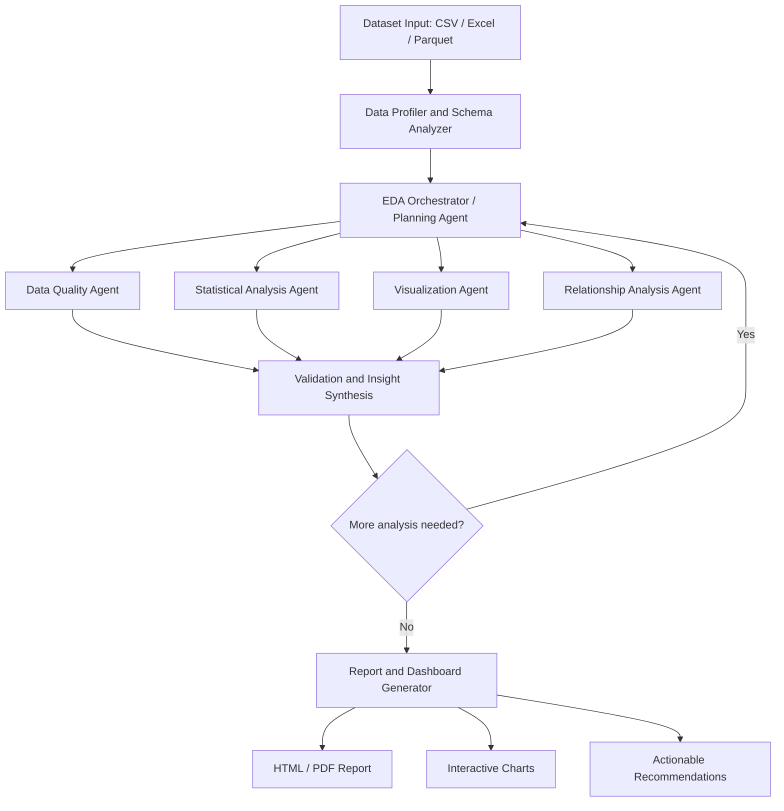

# Agentic Pipeline to Automate EDA

An AI-powered, agentic Exploratory Data Analysis (EDA) system that automatically profiles datasets, detects data-quality issues, selects relevant analyses, generates visualizations, validates findings, and produces a comprehensive report with actionable insights.

The goal is to combine **reliable Python-based analytics** with **LLM-powered planning and interpretation**. Python performs calculations; the LLM helps decide what to investigate and explains verified results.

---

## Table of Contents

- [1. Project Overview](#1-project-overview)
- [2. High-Level Architecture](#2-high-level-architecture)
- [3. Quick Start & Installation](#3-quick-start--installation)
- [4. Usage Guide](#4-usage-guide)
  - [4.1 Command Line Interface (CLI)](#41-command-line-interface-cli)
  - [4.2 Streamlit Interactive Web Studio](#42-streamlit-interactive-web-studio)
  - [4.3 FastAPI REST API](#43-fastapi-rest-api)
  - [4.4 Docker & Docker Compose](#44-docker--docker-compose)
- [5. Agent Responsibilities](#5-agent-responsibilities)
- [6. Agentic Workflow & Feedback Loop](#6-agentic-workflow--feedback-loop)
- [7. Project Structure](#7-project-structure)
- [8. Shared State Design](#8-shared-state-design)
- [9. Safety, Sandboxing & Reliability](#9-safety-sandboxing--reliability)
- [10. Evaluation Strategy](#10-evaluation-strategy)
- [11. Testing & CI/CD](#11-testing--cicd)

---

## 1. Project Overview

Traditional EDA notebooks generally follow a fixed sequence of operations. This project builds a system that **adapts its analysis plan to the dataset it receives**.

### Core Capabilities

- **Multi-format Ingestion:** Accepts CSV, Excel (`.xlsx`, `.xls`), and Parquet (`.parquet`) datasets.
- **Automated Schema & Semantic Typing:** Detects numerical, categorical, datetime, text, boolean, and identifier columns.
- **Target Variable Inference:** Identifies candidate targets (classification or regression) using naming semantics and cardinality distributions without forcing targets when unneeded.
- **Deep Data Quality Audit:** Audits missing values, exact and identifier duplicates, IQR and Z-score outliers, zero-variance columns, and high-cardinality features, computing an overall 0-100 Quality Health Score.
- **Statistical Rigor:** Computes descriptive stats, Pearson and Spearman correlation matrices, Cramér's V associations, and runs hypothesis tests (Two-Sample t-test, Mann-Whitney U, Chi-square independence) with assumption checking.
- **Publication-Ready Visualizations:** Automatically creates interactive Plotly distributions, boxplots, category counts, correlation heatmaps, and target-feature breakdowns.
- **Validation Agent:** Cross-references draft insights against exact computed metrics to eliminate hallucinations and sanitizes causal exaggerations into associative statements.
- **Interactive Reports & Artifacts:** Produces self-contained interactive HTML reports, structured JSON profiles, and summary CSV files.

### Design Principle

> **Use deterministic Python tools for calculations and an LLM for planning, interpretation, and summarization.** Do not rely on an LLM to invent statistics or execute unrestricted generated code.

---

## 2. High-Level Architecture



---

## 3. Quick Start & Installation

### Prerequisites
- Python 3.11+
- Git

### 1. Clone & Set Up Virtual Environment

```bash
# Clone the repository
git clone <repo-url>
cd "Agentic Pipeline to Automate EDA"

# Create virtual environment
python3 -m venv .venv
source .venv/bin/activate

# Install dependencies
pip install -r requirements.txt
```

### 2. Environment Configuration (Optional)

Copy the `.env.example` file:

```bash
cp .env.example .env
```

Set your LLM API keys if available:
```env
# Optional: system defaults to deterministic heuristic mode if keys are omitted
GEMINI_API_KEY=your_gemini_api_key_here
# or
OPENAI_API_KEY=your_openai_api_key_here
```

---

## 4. Usage Guide

### 4.1 Command Line Interface (CLI)

Run full end-to-end agentic EDA directly on any dataset:

```bash
# Run on sample churn dataset with target column
python -m app.main --file data/customer_churn.csv --target Exited

# Run unsupervised EDA without a target
python -m app.main --file data/customer_churn.csv

# Customize objective and feedback iterations
python -m app.main --file data/customer_churn.csv --target Exited --objective "Analyze drivers of customer attrition" --iterations 2
```

The output summary prints directly to your console, and the generated interactive HTML report is saved to `artifacts/reports/eda_report.html`.

### 4.2 Streamlit Interactive Web Studio

Launch the interactive web UI:

```bash
streamlit run app/ui.py
# Or:
python -m app.main --ui
```

Access the studio at `http://localhost:8501`:
1. Upload your CSV, Excel, or Parquet dataset (or choose the included customer churn dataset).
2. Select your target variable (or let the system infer it).
3. Click **Run Agentic EDA** to monitor step-by-step agent execution.
4. Explore tabs for Data Quality, Schema, Statistics, Hypothesis Tests, Interactive Charts, and Download the standalone HTML report.

### 4.3 FastAPI REST API

Start the REST backend server:

```bash
python -m app.main --serve --port 8000
```

Access interactive Swagger documentation at `http://localhost:8000/docs`:
- `GET /health`: Health status.
- `POST /api/upload`: Upload dataset file.
- `POST /api/analyze`: Trigger background EDA job.
- `GET /api/status/{job_id}`: Poll job status.
- `GET /api/report/{job_id}`: Fetch completed report (JSON or HTML).
- `GET /api/artifacts/{filename}`: Download generated charts or reports.

### 4.4 Docker & Docker Compose

Run the entire application in isolated containers:

```bash
docker compose up --build
```

- Streamlit Web App: `http://localhost:8501`
- FastAPI REST Backend: `http://localhost:8000`

---

## 5. Agent Responsibilities

| Agent | Module | Responsibilities |
|---|---|---|
| **Dataset Understanding** | `agents/dataset_agent.py` | Detects data types, cardinality, missingness, and infers candidate targets. |
| **Planning Agent** | `agents/planner.py` | Adapts analysis plan based on dataset profile and user objectives. |
| **Data Quality Agent** | `agents/quality_agent.py` | Flags missing values, duplicates, outliers, zero variance, and calculates quality score (0-100). |
| **Statistical Analysis** | `agents/statistics_agent.py` | Computes descriptive statistics, distributions, skewness, and correlation matrices. |
| **Visualization Agent** | `agents/visualization_agent.py` | Produces interactive Plotly charts (histograms, boxplots, heatmaps, counts). |
| **Relationship Agent** | `agents/relationship_agent.py` | Analyzes target class balance and executes hypothesis tests (t-test, Mann-Whitney U, Chi-square). |
| **Validation Agent** | `agents/validation_agent.py` | Cross-verifies claims against calculated ground truth and sanitizes causal overstatements. |
| **Insight & Reporting** | `agents/insight_agent.py` | Synthesizes verified findings and actionable preprocessing recommendations. |

---

## 6. Agentic Workflow & Feedback Loop

Unlike fixed static notebooks, the agentic pipeline uses a stateful feedback loop orchestrated by **LangGraph**:

1. **Ingest & Profile:** Calculate schema, data types, missingness, and cardinality.
2. **Plan:** The Planning Agent selects approved analysis tasks tailored to the profile.
3. **Execute:** Deterministic Python tools execute allowlisted calculations.
4. **Synthesize:** Insights are generated citing exact numerical evidence.
5. **Validate:** The Validation Agent checks claims against ground truth. If quality issues warrant deeper investigation and the iteration budget allows, the workflow loops back to refine the plan.
6. **Report:** Generates the final HTML report and exports structured artifacts.

---

## 7. Project Structure

```text
agentic-eda/
├── app/
│   ├── main.py                  # CLI and server entry points
│   ├── ui.py                    # Streamlit interactive dashboard
│   └── api/
│       └── routes.py            # FastAPI REST endpoints
├── agents/
│   ├── planner.py               # Planning Agent
│   ├── dataset_agent.py         # Dataset Understanding Agent
│   ├── quality_agent.py         # Data Quality Agent
│   ├── statistics_agent.py      # Statistical Analysis Agent
│   ├── visualization_agent.py   # Visualization Agent
│   ├── relationship_agent.py    # Relationship Analysis Agent
│   ├── insight_agent.py         # Insight Synthesis Agent
│   └── validation_agent.py      # Validation & Ground-truth Audit Agent
├── tools/
│   ├── profiling.py             # Schema detection & data ingestion
│   ├── data_quality.py          # Missingness, duplicates, outlier detection
│   ├── statistical_tests.py     # Summary stats, correlations, hypothesis tests
│   ├── chart_generator.py       # Plotly chart generation
│   └── safe_executor.py         # Sandboxed allowlist tool dispatcher
├── workflow/
│   ├── graph.py                 # LangGraph state machine & feedback loop
│   ├── state.py                 # TypedDict shared state definition
│   ├── prompts.py               # Agent prompt templates
│   └── llm_client.py            # Unified LLM provider (Gemini, OpenAI, Heuristic)
├── reporting/
│   ├── report_generator.py      # HTML and artifact export compiler
│   └── templates/
│       └── report.html          # Jinja2 modern responsive report template
├── tests/
│   ├── test_quality.py          # Unit tests for data quality audit
│   ├── test_statistics.py       # Unit tests for statistical calculations
│   └── test_workflow.py         # End-to-end integration & API tests
├── data/
│   ├── customer_churn.csv       # Sample benchmark dataset
│   └── .gitkeep
├── artifacts/
│   └── .gitkeep                 # Output charts, reports, and JSON summaries
├── .github/
│   └── workflows/
│       └── ci.yml               # GitHub Actions CI matrix
├── Dockerfile                   # Container specification
├── docker-compose.yml           # Multi-container orchestration
├── requirements.txt             # Project dependencies
├── .env.example                 # Environment variable template
├── .gitignore                   # Git exclusion rules
└── README.md                    # Project documentation
```

---

## 8. Shared State Design

The agents communicate via a typed dictionary state:

```python
class EDAState(TypedDict, total=False):
    dataset_path: str
    dataset_name: str
    target_column: str | None
    user_objective: str
    schema: dict[str, Any]
    data_profile: dict[str, Any]
    quality_findings: list[dict[str, Any]]
    quality_score: float
    analysis_plan: list[dict[str, Any]]
    plan_reasoning: str
    statistical_results: dict[str, Any]
    relationship_results: dict[str, Any]
    hypothesis_test_results: list[dict[str, Any]]
    chart_paths: list[str]
    chart_metadata: list[dict[str, Any]]
    validated_insights: list[dict[str, Any]]
    actionable_recommendations: list[dict[str, Any]]
    warnings: list[str]
    validation_passed: bool
    requires_further_analysis: bool
    iteration: int
    max_iterations: int
    final_report_path: str
```

---

## 9. Safety, Sandboxing & Reliability

- **No Arbitrary Code Execution:** The system never evaluates unverified LLM-generated Python or shell code. Tools are invoked strictly through `SafeExecutor` with an explicit allowlist.
- **Hallucination Prevention:** The Validation Agent checks reported statistics directly against calculation outputs.
- **Causality Sanitization:** Phrases implying causality ("causes", "drives") are flagged and replaced with associative terms ("correlates with", "is associated with").
- **Offline / Deterministic Fallback:** Runs reliably in offline environments without external API keys using built-in statistical heuristics.

---

## 10. Evaluation Strategy

| Metric | What it measures | Target |
|---|---|---|
| **Finding Correctness** | Numerical claims match computed results | 100% |
| **Analysis Coverage** | Schema, quality, stats, charts, and target coverage | Complete |
| **Unsupported-Claim Rate** | Percentage of claims without supporting evidence | 0% |
| **Task Success Rate** | Pipeline completion without unhandled exceptions | 100% |
| **Reproducibility** | Deterministic outputs across multiple runs on identical data | Guaranteed |

---

## 11. Testing & CI/CD

Run the test suite:

```bash
pytest -v tests/
```
---

## 👨‍💻 Author

<div align="center">

<a href="https://github.com/iitking">
  
</a>

### **Nivesh Kumar Meena**

**AI Architect · MLOps Engineer** | B.Tech Electrical Engineering, **IIT Roorkee**

*Building agentic AI systems, RAG pipelines and production-ready ML.*

<a href="https://www.linkedin.com/in/nivesh-kumar-meena-a31465221/"></a>
<a href="https://github.com/iitking"></a>
<a href="mailto:niveshkr149@gmail.com"></a>

<br/><br/>

⭐ **If you found this project useful, please give it a star!** ⭐

<sub>Open to AI/ML engineering opportunities and collaborations.</sub>

</div>

---

<div align="center">
  <sub>Made with ❤️ by <a href="https://github.com/iitking">Nivesh Kumar Meena</a> · © 2026 · MIT License</sub>
</div>

