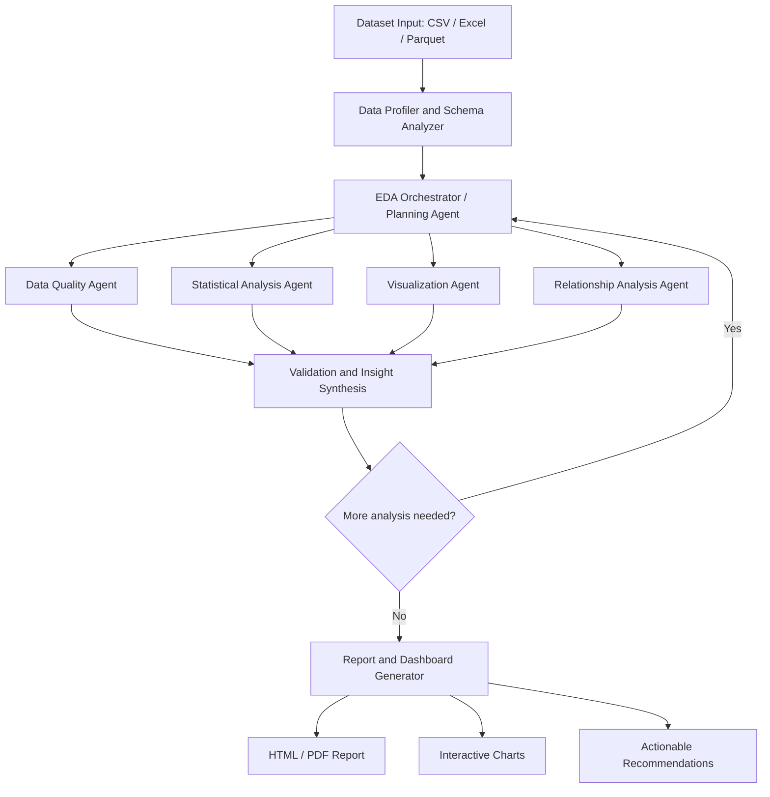

# Agentic Pipeline to Automate EDA

An AI-powered, agentic Exploratory Data Analysis (EDA) system that automatically profiles datasets, detects data-quality issues, selects relevant analyses, generates visualizations, validates findings, and produces a comprehensive report with actionable insights.

The goal is to combine **reliable Python-based analytics** with **LLM-powered planning and interpretation**. Python performs calculations; the LLM helps decide what to investigate and explains verified results.

---

## Table of Contents

- [1. Project Overview](#1-project-overview)
- [2. High-Level Architecture](#2-high-level-architecture)
- [3. Quick Start & Installation](#3-quick-start--installation)
- [4. Usage Guide](#4-usage-guide)
  - [4.1 Command Line Interface (CLI)](#41-command-line-interface-cli)
  - [4.2 Streamlit Interactive Web Studio](#42-streamlit-interactive-web-studio)
  - [4.3 FastAPI REST API](#43-fastapi-rest-api)
  - [4.4 Docker & Docker Compose](#44-docker--docker-compose)
- [5. Agent Responsibilities](#5-agent-responsibilities)
- [6. Agentic Workflow & Feedback Loop](#6-agentic-workflow--feedback-loop)
- [7. Project Structure](#7-project-structure)
- [8. Shared State Design](#8-shared-state-design)
- [9. Safety, Sandboxing & Reliability](#9-safety-sandboxing--reliability)
- [10. Evaluation Strategy](#10-evaluation-strategy)
- [11. Testing & CI/CD](#11-testing--cicd)

---

## 1. Project Overview

Traditional EDA notebooks generally follow a fixed sequence of operations. This project builds a system that **adapts its analysis plan to the dataset it receives**.

### Core Capabilities

- **Multi-format Ingestion:** Accepts CSV, Excel (`.xlsx`, `.xls`), and Parquet (`.parquet`) datasets.
- **Automated Schema & Semantic Typing:** Detects numerical, categorical, datetime, text, boolean, and identifier columns.
- **Target Variable Inference:** Identifies candidate targets (classification or regression) using naming semantics and cardinality distributions without forcing targets when unneeded.
- **Deep Data Quality Audit:** Audits missing values, exact and identifier duplicates, IQR and Z-score outliers, zero-variance columns, and high-cardinality features, computing an overall 0-100 Quality Health Score.
- **Statistical Rigor:** Computes descriptive stats, Pearson and Spearman correlation matrices, Cramér's V associations, and runs hypothesis tests (Two-Sample t-test, Mann-Whitney U, Chi-square independence) with assumption checking.
- **Publication-Ready Visualizations:** Automatically creates interactive Plotly distributions, boxplots, category counts, correlation heatmaps, and target-feature breakdowns.
- **Validation Agent:** Cross-references draft insights against exact computed metrics to eliminate hallucinations and sanitizes causal exaggerations into associative statements.
- **Interactive Reports & Artifacts:** Produces self-contained interactive HTML reports, structured JSON profiles, and summary CSV files.

### Design Principle

> **Use deterministic Python tools for calculations and an LLM for planning, interpretation, and summarization.** Do not rely on an LLM to invent statistics or execute unrestricted generated code.

---

## 2. High-Level Architecture

---

## 3. Quick Start & Installation

### Prerequisites
- Python 3.11+
- Git

### 1. Clone & Set Up Virtual Environment

